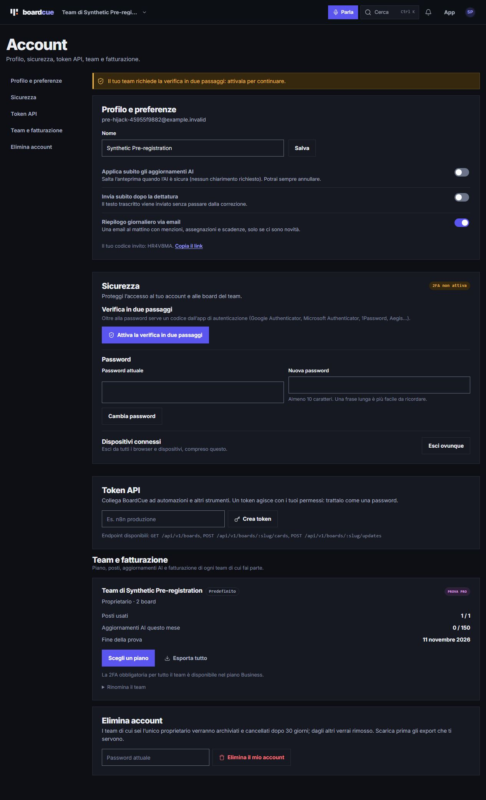
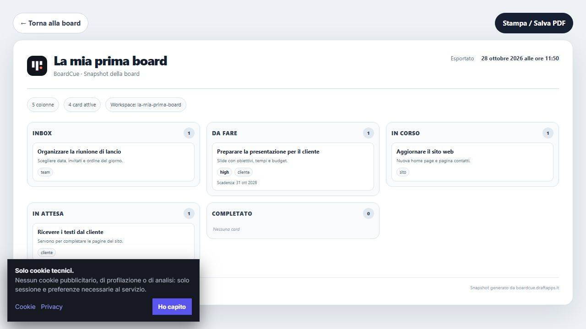

# BoardCue / PlanPilot — analisi di sicurezza e solidità

Data: **28 ottobre 2026**, fuso di riferimento Europe/Berlin.

> Fotografia precedente alle correzioni. Gli interventi successivi e la loro validazione sono nel [rapporto di correzione](SECURITY_REMEDIATION_2026-10-28.md); le prove originali sotto restano invariate.

## Giudizio

**Rischio complessivo alto.** Esistono difese strutturali valide, ma sono state riprodotte tre vulnerabilità applicative prioritarie: escalation da SUPPORT/BILLING a SUPERADMIN, accesso a contenuti nonostante la 2FA obbligatoria e persistenza dell'accesso di chi preregistra l'email di un'altra persona. Sono presenti ulteriori problemi di concorrenza, isolamento delle informazioni e resilienza operativa.

Non considererei superato un controllo di sicurezza prima di correggere questi tre flussi e aggiungere test che ne impediscano la regressione. Questo giudizio riguarda il codice esaminato e la replica locale. **Le falle autenticate non sono state sfruttate sul sito di produzione**, di cui non è stata verificata la corrispondenza con il checkout.

## Perimetro, metodo e limiti

- Repository: `C:\Users\loren\Documents\GitHub\PlanPilot`; commit base `14fd7c57fa077bf6018a5064393f82f70e6b8ad4`, con modifiche locali preesistenti. Il checkout era in evoluzione durante l'analisi. Nessun file applicativo è stato corretto o ripristinato dall'audit.
- Mappate **81 route API**; esaminati autenticazione, sessioni, ruoli, guardie condivise, accesso alle board, modifiche transazionali, proposte AI, import/export, webhook, Telegram, calendario, push, PWA, dipendenze, Docker, CI e backup.
- Sito pubblico: `https://boardcue.draftapps.it`, verificato da browser e con **26 richieste GET/OPTIONS** a basso volume. Nessuna registrazione, email, operazione di pagamento o modifica di dati in produzione.
- Replica: build di produzione Next.js, PostgreSQL temporaneo in ascolto solo su loopback e account `example.invalid`. Provider AI, SMTP, Stripe, Telegram e push disabilitati. Le prove sulle API usano richieste HTTP reali; quelle su funzioni specifiche sono esplicitamente indicate.
- Ambiente di esecuzione della replica: Windows, Node.js 24.18.0 e PostgreSQL embedded 18.4; il deployment descritto dal Dockerfile/Compose usa invece Node.js 22 Alpine e PostgreSQL 16. Le prove non sostituiscono una ripetizione sul runtime del deployment. Gli hash dei sorgenti di sicurezza sono in [source-snapshot.json](security/2026-10-28/source-snapshot.json).
- Le verifiche del secondo fattore nel browser sono state svolte con un account sintetico. Il suo accesso normale viene bloccato, mentre la stampa mostra le card.
- Esclusi: accesso autenticato alla produzione, verifica di WAF/reverse proxy/firewall effettivi, configurazione privata del cloud, restore di backup reali, test distruttivi o di carico, exploit RCE, scansione completa della cronologia Git e verifica indipendente delle pratiche dei fornitori AI. Una revisione applicativa non può attestare l'assenza di ogni vulnerabilità.

## Risultati esecutivi

| Verifica | Esito | Evidenza |
|---|---|---|
| Suite iniziale senza DB dedicato | 359 passati, 34 saltati | I test PostgreSQL sono opt-in |
| Suite completa con PostgreSQL isolato | **395 passati, 40 file, nessun test saltato** | [local-evidence.json](security/2026-10-28/local-evidence.json) |
| Controllo TypeScript iniziale e finale | Superato | `npm run typecheck`; anche gli strumenti di audit risultano tipizzati correttamente |
| Build di produzione | Superata | Next.js 15.5.25, PWA generata |
| E2E desktop esistenti | **16 passati, 4 falliti, 2 saltati** | [log E2E](security/2026-10-28/e2e-desktop.log) |
| E2E autenticato PWA, esecuzione separata con DB opt-in | **1 passato** | [log autenticato](security/2026-10-28/e2e-authenticated.log) |
| Audit dipendenze completo | **10 pacchetti segnalati: 3 critical, 5 high, 2 moderate** | [npm audit](security/2026-10-28/npm-audit.json) |
| Audit dipendenze di produzione | **6 pacchetti: 1 critical, 4 high, 1 moderate** | [npm audit produzione](security/2026-10-28/npm-audit-production.json) |
| Superficie pubblica e TLS | Controlli essenziali superati | [public-evidence.json](security/2026-10-28/public-evidence.json) |

I pacchetti segnalati non equivalgono ad altrettante vulnerabilità sfruttabili nell'app. Anche i test verdi non coprono automaticamente i casi di abuso: le prove mirate qui sotto hanno trovato problemi non intercettati dalla suite esistente.

## Registro dei rilievi

Gravità applicativa contestualizzata, senza attribuire punteggi CVSS artificiali. «Riprodotto» significa verificato sulla replica o sulla funzione indicata, non sfruttato in produzione.

| ID | Gravità | Problema | Stato |
|---|---|---|---|
| SEC-01 | Alta | SUPPORT e BILLING possono diventare SUPERADMIN | Riprodotto via HTTP |
| SEC-02 | Alta | La 2FA obbligatoria non copre tutte le vie di lettura | Riprodotto via HTTP e browser |
| SEC-03 | Alta | Preregistrazione di email altrui con accesso persistente dopo verifica | Riprodotto via HTTP, conferma mailbox simulata |
| SEC-04 | Alta, manutenzione | Dipendenze con advisory, incluse Next.js/sharp | Versioni confermate; exploit non eseguiti |
| SEC-05 | Media | API amministrative accettano richieste di origine estranea | Riprodotto; attacco browser condizionato da SameSite |
| SEC-06 | Media | Filtro SSRF aggirabile con IPv4 mappato in IPv6; risoluzione DNS non vincolata | Bypass del validatore riprodotto; accesso interno non eseguito |
| SEC-07 | Media | Il link reset password non è consumato atomicamente | Due reset simultanei accettati |
| SEC-08 | Media | Lo stesso codice di recupero 2FA può essere consumato due volte | Due chiamate concorrenti alla funzione accettate |
| SEC-09 | Media | Due modifiche concorrenti possono eliminare tutti gli owner di una board | Riprodotto con interleaving controllato |
| SEC-10 | Media | Il titolo di una board privata compare prima dell'autorizzazione | Riprodotto con estraneo e cookie invalido |
| SEC-11 | Media | Formule non neutralizzate nell'export CSV | Output della funzione riprodotto |
| SEC-12 | Media, condizionata | IP e host inoltrati trattati come attendibili | Bypass locale riprodotto; proxy pubblico non verificato |
| SEC-13 | Media, operativa | Un backup può risultare riuscito dopo fallimento di pg_dump | Revisione e prova della semantica della pipeline |
| SEC-14 | Bassa | CSP di produzione consente script inline | Confermato anche sul sito pubblico |

### SEC-01 — escalation dei ruoli nel back office

**Posizione:** `app/api/admin/users/route.ts:118–154`, in particolare linee 125 e 127; `lib/platform-access.ts`.

`requireAdmin()` ammette i ruoli con capacità METADATA, fra cui SUPPORT e BILLING. La protezione per chi non è superadmin controlla `platformRole` e `lifetimeFree`, ma omette `isAdmin`. Subito dopo, `isAdmin: true` viene tradotto in `platformRole: SUPERADMIN`.

**Riproduzione locale:** con un account SUPPORT, e separatamente con BILLING, inviare `PATCH /api/admin/users` con `{ "id": "<id dello stesso account>", "isAdmin": true }`. Entrambe le richieste restituiscono **200**; il database conferma `SUPERADMIN` e `isAdmin: true`.

**Impatto:** un ruolo amministrativo limitato può acquisire le capacità globali di gestione utenti, licenze e lifecycle. Non è sufficiente un account ordinario USER: serve SUPPORT o BILLING, oppure il controllo della relativa sessione.

**Correzione:** normalizzare prima gli alias legacy e autorizzare il cambiamento effettivo; vietare a chi non è superadmin qualsiasi campo che modifichi il ruolo. Preferibile rimuovere `isAdmin` dagli input pubblici. Testare SUPPORT e BILLING contro `platformRole`, `isAdmin`, combinazioni e tentativi su sé stessi/altri utenti. Verificare nel log amministrativo eventuali transizioni anomale già avvenute.

### SEC-02 — applicazione incompleta della 2FA obbligatoria

**Posizione:** `app/api/search/route.ts:7`, `app/app/[slug]/print/page.tsx:17`, `app/api/organizations/[organizationId]/export/route.ts:5`, `lib/api-v1.ts:11–29`; anche la creazione token in `app/api/account/tokens/route.ts` manca del controllo comune.

La guardia della board invoca `twoFactorRequiredButMissing()`, ma altre vie di accesso non lo fanno. Con un membro senza TOTP in un'organizzazione `require2fa: true`:

| Percorso locale | Risultato |
|---|---|
| `/api/workspaces/:slug/board` | **403**, blocco corretto |
| `/api/search?q=AUDIT` | **200**, titolo della card esposto |
| `/app/:slug/print` | **200**, card e descrizioni esposte |
| `/api/organizations/:id/export` | **200**, contenuti esportati |
| `/api/v1/boards/:slug/cards` con token preesistente | **200**, contenuti esposti |

**Prova browser:** il login porta a `/account?require2fa=1#security` con l'avviso che la 2FA è necessaria; navigando direttamente alla stampa si visualizza la stessa board senza configurarla.

**Impatto:** la policy organizzativa è aggirabile per la lettura/esportazione; il furto della sola password conserva valore anche quando l'amministratore impone il secondo fattore. Non è un bypass del TOTP già attivato nel login di un account: è un bypass dell'enforcement di configurazione.

**Correzione:** usare una policy comune per tutte le letture, esportazioni e API, incluse pagine server e token personali. Consentire prima dell'enrollment soltanto gli endpoint necessari a completarlo e al logout. Specificare esplicitamente la policy per token e feed già emessi, poi applicarla in modo uniforme.

### SEC-03 — account pre-hijacking nel flusso email

**Posizione:** `app/api/auth/register/route.ts:42–90`, `app/api/auth/verify/route.ts`, `app/api/auth/magic/route.ts`, `lib/verification.ts`.

Un soggetto può registrare l'email di un'altra persona scegliendo la password e ricevendo immediatamente una sessione. Se il titolare della mailbox verifica successivamente quell'account, il codice imposta `emailVerifiedAt` ma conserva sia la password iniziale sia le sessioni precedenti. Una nuova registrazione con quell'email non sostituisce la password: invia un'ulteriore email di verifica.

**Riproduzione:** registrazione sintetica **201**; conferma attraverso la vera route di verifica **307**; sessione originaria ancora accettata **200**; confronto bcrypt conferma che la password scelta dal preregistrante è ancora valida. Per simulare il clic del legittimo destinatario il test inserisce un token noto nel DB temporaneo: non accede né intercetta una mailbox reale.

**Impatto e condizioni:** possibile accesso persistente a un account che una vittima crede di avere appena attivato. Richiede preregistrare l'indirizzo prima del titolare e che questo completi il flusso di verifica/accesso. Non dimostra il takeover di account già verificati.

**Correzione:** distinguere gli spazi di prova non verificati dall'identità email acquisita. Dopo la prova di possesso della mailbox il titolare deve poter definire credenziali affidabili, invalidando password e sessioni originate prima della verifica. La sola revoca delle sessioni non basta se resta valida la password scelta dall'attaccante. Applicare lo stesso modello alla prima verifica via magic link e invito.

### SEC-04 — dipendenze vulnerabili e applicabilità

**Posizione:** `package.json`, `package-lock.json`, `Dockerfile`, workflow CI.

| Pacchetto installato | Audit | Ambito | Trattamento consigliato |
|---|---|---|---|
| next 15.5.25 | Critical | Produzione | Aggiornare almeno a 15.5.28 e verificare le patch successive pertinenti |
| sharp 0.35.4 | High | Produzione, override esplicito | Correggere l'override ad almeno 0.35.5; l'override vecchio può vanificare l'upgrade transitivo |
| nodemailer 9.1.1 | High | Produzione | Audit propone 10.2.1; migrazione con verifica SMTP |
| zod 3.25.76 | High | Produzione | Audit propone 4.6.7; migrazione maggiore e controlli sui limiti prima della validazione |
| source-map-js 1.2.1 | High | Dipendenza di produzione | Risolvere ad almeno 1.2.2; verificare la catena effettivamente usata a runtime |
| qs 6.16.0 | Moderate | Produzione | Aggiornare la dipendenza transitiva oltre il range dell'advisory |
| vitest 3.2.7 / tinypool 1.1.1 | Critical | Sviluppo/test | Aggiornare la toolchain; audit propone Vitest 5.0.5 |
| vite 7.3.6 | High | Sviluppo/test | Aggiornare insieme alla toolchain |
| @vitest/mocker 3.2.7 | Moderate | Sviluppo/test | Aggiornare insieme a Vitest |

**Precisazioni di esposizione:**

- L'advisory Next.js sull'ottimizzazione immagini descrive possibile RCE su Linux **glibc**. Il Dockerfile usa Alpine; non è stata eseguita una RCE né dimostrata la presenza delle condizioni necessarie su produzione. Non risulta un flusso applicativo di upload immagini verso l'optimizer.
- L'advisory DoS sulle Server Actions richiede almeno una Server Action. La build ispezionata ha **zero azioni** nei manifest node/edge e la ricerca non trova `use server`: quel percorso specifico non risulta applicabile a questa build.
- Vitest/tinypool sono dipendenze di sviluppo e vengono eliminate dal runtime Docker con `npm prune --omit=dev`; non vanno presentate come RCE remota del sito.
- Molti advisory Nodemailer richiedono input SMTP/parser non esposti direttamente dai form con email validate. La presenza della versione vulnerabile è confermata; non tutti i singoli attacchi lo sono.
- Non è stato inviato alcun payload di esaurimento risorse. La maggioranza delle route legge l'intero JSON/form prima di applicare i limiti: servono limiti di byte sul body e rate limit anche prima dei parser.

Fonti primarie/advisory consultati il 28 ottobre 2026: [Next.js immagini](https://github.com/vercel/next.js/security/advisories/GHSA-2464-fhr4-w9xw), [Next.js Server Actions](https://github.com/vercel/next.js/security/advisories/GHSA-p3m5-59mp-jv5r), [Zod](https://github.com/advisories/GHSA-mrhx-c7xc-m3w5), [Tinypool](https://github.com/advisories/GHSA-5gmw-xhrv-c9v3). Gli altri riferimenti e range esatti sono nei JSON dell'audit. Non è stato eseguito `npm audit fix`.

### SEC-05 — assenza di verifica Origin in API amministrative

**Posizione:** varie route sotto `app/api/admin`, fra cui `users`, `memberships`, `licenses`, `lifecycle`. La route `ai-models` invece controlla l'origine.

**Prova locale:** un `POST /api/admin/users` autenticato da superadmin, con `Origin: https://attacker.example` e `Content-Type: text/plain`, viene accettato e crea un utente sintetico (**201**). `request.json()` legge il body anche con quel content type.

**Condizioni browser:** i cookie di sessione `SameSite=Lax` contrastano il classico POST da un sito totalmente esterno. L'assenza resta sfruttabile in scenari **same-site**, ad esempio da un sottodominio compromesso dello stesso dominio registrabile: il browser può inviare il cookie al destinatario e un POST semplice non richiede di leggere la risposta. Non è stato ospitato un sito di attacco né dimostrata la compromissione di un sottodominio reale.

**Correzione:** guardia comune sulle mutazioni amministrative, confronto con origine configurata, difesa CSRF coerente e controllo dei content type. Proteggere anche il logout, che attualmente non verifica Origin. Aggiungere test per POST semplici, sottodomini e richieste prive di Origin.

### SEC-06 — validatore SSRF incompleto

**Posizione:** `lib/webhooks.ts:77–117` e `:191–192`.

Le forme IPv4 sono filtrate, ma un URL con IPv4 mappato in IPv6 viene normalizzato da `URL` in forma esadecimale e sfugge ai confronti testuali:

| URL passato alla funzione | Esito |
|---|---|
| `https://127.0.0.1` | Rifiutato |
| `https://[::1]` | Rifiutato |
| `https://[::ffff:127.0.0.1]` | **Accettato**, normalizzato a `[::ffff:7f00:1]` |
| `https://[::ffff:169.254.169.254]` | **Accettato** |
| `https://[::ffff:192.168.1.1]` | **Accettato** |

Inoltre la verifica DNS e la successiva `fetch()` effettuano risoluzioni separate: non è vincolata la connessione all'indirizzo verificato.

**Limite della prova:** riprodotto il bypass di `assertSafeWebhookUrl`, senza contattare metadata cloud o servizi interni. Il trasporto resta HTTPS con verifica certificato; reachability di rete, certificati e DNS determinano se il bypass diventa una richiesta applicativa utile. I redirect sono correttamente rifiutati.

**Correzione:** normalizzazione robusta degli indirizzi, riconoscimento degli IPv4 mappati, blocco degli intervalli speciali e verifica dell'IP realmente usato dalla connessione. Affiancare un controllo egress a livello di rete; preferire allowlist dove il prodotto lo consente.

### SEC-07 — reset password riutilizzabile in concorrenza

**Posizione:** `app/api/auth/reset-password/route.ts:16`.

La validità del token viene letta prima del calcolo bcrypt e della transazione. L'aggiornamento del token non impone `usedAt: null`. **Due POST simultanei con lo stesso token hanno entrambi restituito 200.**

Il possesso del token è un prerequisito; non è stata dimostrata la possibilità di indovinarlo. La race viola la garanzia di uso singolo e rende ambiguo quale password prevalga.

**Correzione:** claim condizionale del token e modifica password nella stessa transazione; solo un claim può riuscire. Definire anche una policy esplicita di contenimento: nella prova un API token antecedente al reset continua a leggere le card (**200**), e il codice non invalida magic link e challenge preesistenti. La sopravvivenza dei token personali può essere una scelta di prodotto, ma il recupero di un account compromesso deve permetterne la revoca completa.

### SEC-08 — consumo non atomico dei recovery code

**Posizione:** `lib/two-factor.ts:29–46`; `lib/totp.ts:126` e seguenti.

Il codice TOTP usa un claim condizionale di `totpLastStep`, utile contro il replay. I recovery code invece vengono letti dall'oggetto utente e riscritti senza confronto con lo stato corrente. Due chiamate concorrenti a `checkUserCode()` con lo stesso codice e la stessa versione dell'utente restituiscono **[true, true]**.

**Limite:** la prova riguarda la funzione condivisa, non due login completi: la cancellazione della challenge può bloccare una delle due sessioni nello stesso login. La proprietà di consumo singolo resta violata e la funzione è usata anche nella gestione della 2FA.

**Correzione:** modellare i recovery code come record consumabili atomicamente o bloccare e verificare nuovamente l'utente dentro una transazione. Applicare lo stesso principio ai limiti di tentativi e alle operazioni di rigenerazione/disabilitazione.

### SEC-09 — perdita dell'ultimo owner per race

**Posizione:** `app/api/workspaces/[slug]/members/[userId]/route.ts:18–28` e `:50–52`; logica analoga da controllare nelle route amministrative.

Il conteggio degli owner avviene prima della transazione. Con due owner, due demozioni parallele possono entrambe osservare `count = 2` e completare lasciando **zero owner**.

**Prova:** in una board sintetica con due proprietari, una transazione di test mantiene brevemente il lock sulle membership per rendere ripetibile l'interleaving fra letture e scritture. Le due richieste HTTP terminano **[200, 200]**, il conteggio finale degli owner è **0**. Senza l'interleaving forzato, una prima esecuzione aveva correttamente negato una delle modifiche: è una race, non un errore sequenziale.

**Correzione:** serializzare la gestione membership per board e rileggere ruolo dell'attore, lifecycle, numero di owner e limite posti dentro la stessa transazione. Il controllo posti della promozione guest ha una verifica esterna simile, da includere nella revisione.

### SEC-10 — titolo privato nei metadati non autorizzati

**Posizione:** `app/app/[slug]/page.tsx:9–12`.

`generateMetadata()` legge il nome tramite slug senza controllare la membership. La pagina controlla l'accesso separatamente e troppo tardi per i metadati.

**Prova:** un utente estraneo ottiene **404**, ma il body include `AUDIT-CONFIDENTIAL-BOARD-TITLE`; anche una richiesta con cookie di sessione inventato ottiene **307** con lo stesso titolo nel body. Il cookie inventato supera solo la verifica di presenza del middleware, non la validazione della sessione: la falla è la divulgazione nei metadati.

**Impatto:** conferma dell'esistenza e nome di progetti privati per slug noto o indovinato, non accesso alle card.

**Correzione:** titolo generico finché sessione, membership e policy non sono state validate; condividere un resolver autorizzato fra pagina e metadati.

### SEC-11 — CSV formula injection

**Posizione:** `lib/import-export.ts:188–195`, usato anche dall'export board e da esportazioni amministrative.

`csvCell()` gestisce la sintassi CSV ma conserva i prefissi interpretati come formule dai fogli di calcolo. Il test genera esattamente una riga `=1+1,@SUM(1+1)`.

**Impatto:** chi controlla nomi, titoli o descrizioni può inserire formule nell'export che un altro utente apre in Excel o applicazioni analoghe. L'esecuzione e i rischi di connessioni esterne dipendono dal client e dalle sue protezioni: non è stato aperto un payload di esfiltrazione.

**Correzione:** esportazione sicura per celle che iniziano con `=`, `+`, `-`, `@`, tab o caratteri di controllo/spazi seguiti da formule; testare il comportamento nei client supportati. Offrire XLSX con celle esplicitamente testuali dove serve maggiore controllo.

### SEC-12 — fiducia negli header del proxy

**Posizione:** `lib/security.ts:11–12`, `:59–76`.

`clientIp()` considera attendibile il primo valore di `X-Forwarded-For`; il controllo Origin accetta host presi da `X-Forwarded-Host`. Sul server locale:

- 10 login malformati con un IP sintetico restituiscono 401, l'undicesimo 429; cambiando soltanto `X-Forwarded-For` si torna a **401**.
- `Origin: https://attacker.example` viene respinto con **403**; aggiungendo `X-Forwarded-Host: attacker.example` la richiesta supera il controllo e raggiunge la validazione credenziali (**401**).

**Condizioni:** l'exploit esterno dipende dal reverse proxy che potrebbe già sovrascrivere o filtrare gli header; ciò non è stato verificato su produzione. Il limite aggiuntivo per account nel login riduce il brute force su una singola email, ma registrazione, recupero e richiesta magic link dipendono principalmente dall'IP. Il fallback in memoria non ha un limite/evizione delle chiavi: da correggere anche per resilienza durante outage DB.

**Correzione:** definire proxy attendibili, impedire accesso diretto al servizio e ignorare i valori client non affidabili. Usare l'origine canonica configurata per il CSRF. Combinare limiti IP e identità/destinazione, evitando di trasformarli in blocchi facili da usare contro le vittime.

### SEC-13 — backup falsamente riuscito

**Posizione:** `scripts/backup-db.sh`.

Lo script dichiara `#!/bin/sh` e `set -eu`, ma esegue `pg_dump | openssl enc`. In una pipeline POSIX viene restituito lo stato dell'ultimo comando: un fallimento del dump può essere mascherato dall'encryption di uno stream vuoto riuscita. Lo script può quindi stampare successo e avviare la pulizia dei backup vecchi.

**Prova non distruttiva:** `set -eu; false | cat; echo PIPELINE_REPORTED_SUCCESS` termina con codice **0** e stampa il marcatore. Nessun backup reale è stato creato, cancellato o ripristinato.

**Correzione:** controllare separatamente il risultato del dump, verificare l'archivio e pubblicarlo con rename atomico soltanto a fine procedura. Eseguire la retention solo dopo un backup validato. Aggiungere cifratura autenticata/verifica di integrità, copia esterna e restore drill che verifichi anche contenuti attesi, non soltanto il ritorno dei comandi.

### SEC-14 — CSP con unsafe-inline

**Posizione:** `next.config.ts:4–6`; stesso header osservato su produzione.

La direttiva `script-src` include `'unsafe-inline'`. Le protezioni `frame-ancestors 'none'`, `base-uri` e `form-action` sono utili, ma un'eventuale HTML injection avrebbe una difesa aggiuntiva più debole. Non è stata trovata o sfruttata una XSS: i punti di HTML esplicito esaminati sono script statico del tema, JSON-LD con escaping di `<` e SVG QR generato sul server.

**Correzione:** nonce/hash per gli script necessari e rimozione progressiva di `unsafe-inline`, con verifica della compatibilità Next.js e Stripe. Non attivare una CSP restrittiva senza testare login, pagine renderizzate, pagamento e PWA.

## Ulteriori punti di solidità da trattare

Questi punti sono emersi dalla revisione e non sono conteggiati come exploit dinamici confermati:

- **Bozze fra account sullo stesso browser:** `HomeAssistant.tsx` usa `sessionStorage['boardcue:home-draft']`, il composer usa chiavi per slug e `UserMenu.logout()` non pulisce le bozze. Il contenuto non inviato può riapparire dopo un cambio account nella stessa scheda. Inserire l'identità nella chiave, pulire al logout e controllare anche l'inbox IndexedDB delle condivisioni. Non è stata eseguita una prova completa di cambio account.
- **Revoca e durata credenziali:** i token API non hanno scadenza o scope granulari. Dopo il reset continuano a funzionare; distinguere logout sessioni, revoca integrazioni e recupero di un account compromesso nell'interfaccia.
- **Cache delle risposte private:** alcune API autenticate nella replica non restituiscono `Cache-Control`. Definire esplicitamente `private, no-store` per dati, token e segreti. Non è stata dimostrata una fuga tramite cache condivisa.
- **Risorse e query:** body JSON/form generalmente letti per intero prima dei controlli di dimensione; stream SSE senza limite di connessioni per utente; alcune letture board/agenda senza paginazione. Aggiungere limiti e backpressure e provarli in staging con un budget di carico concordato.
- **SMTP:** `secure: false` non impone `requireTLS`; verificare che STARTTLS sia obbligatorio e che timeout e policy del provider non consentano fallback in chiaro. Non è stata ispezionata la connessione SMTP reale.
- **Database e gestione chiavi:** separare ruolo di migrazione e ruolo runtime, verificare i privilegi effettivi e una procedura di rotazione di `APP_ENCRYPTION_KEY`. Compose e codice non bastano a confermare l'hardening del deployment.
- **Inviti:** l'accettazione controlla `acceptedAt`, scadenza e revoca prima della transazione, poi aggiorna il record senza claim condizionale; rivalidare sotto lock anche invito e lifecycle. Non è stato riprodotto un abuso concorrente di invito.
- **CI:** `.github/workflows/ci.yml` avvia PostgreSQL ma non imposta `BOARDCUE_TEST_DATABASE_URL` con un DB `boardcue_test_*`. Perciò i test opt-in restano saltati anche quando il servizio DB è presente. Mancano inoltre uno step di audit delle dipendenze e test di regressione per i rilievi di questo rapporto. Il workflow Build usa `npm install`, mentre CI/Docker usano `npm ci`: uniformare la riproducibilità.

## Verifiche dal browser e superficie pubblica

Il browser ha caricato landing e login pubblici senza errori TLS. Le letture non autenticate di API private rispondono 401 e quelle amministrative 403; le pagine private reindirizzano. `.env`, `.git/config` e `package.json` rispondono **404**. Queste tre risposte non costituiscono una scansione completa di file esposti.

TLS verificato con validazione certificato abilitata: **TLS 1.3 / TLS_AES_128_GCM_SHA256**, certificato Let's Encrypt per `boardcue.draftapps.it`, valido dal 9 ottobre 2026 al 7 gennaio 2027. L'HTTP pubblico reindirizza a HTTPS; CORS non apre la lettura dell'API token all'origine di prova. Header presenti: HSTS, `nosniff`, COOP, Referrer-Policy, Permissions-Policy e CSP. L'header di versione del framework non è esposto; `/api/health` risponde correttamente senza credenziali o dettagli del DB, salvo identificativo build.

Il browser locale ha confermato la differenza fra accesso ordinario con enforcement 2FA e stampa senza enforcement. Le schermate sono nelle evidenze. La console di quella pagina non segnala errori.

Gli E2E mostrano quattro problemi da non interpretare automaticamente come vulnerabilità:

1. Il percorso autenticato della board si interrompe perché il banner cookie intercetta il clic sul menu «Completato».
2. Il test prezzi attende Family a €5,00, la pagina mostra €4,50: aspettativa disallineata.
3. Un selettore della demo trova due proposte perché anche le opzioni di spostamento contengono i nomi delle board: selettore ambiguo.
4. Dopo il fallback offline, il test si aspetta `/login`, ma il percorso attuale porta a `/`: aspettativa disallineata. Le verifiche precedenti sull'assenza di cache privata e sul fallback avevano già superato le asserzioni.

Un test autenticato aggiuntivo, con il DB opt-in configurato, ha verificato con successo blocco degli aggiornamenti con bozza aperta, salvataggio di una card e conservazione del testo in caso di errore offline.

## Difese riscontrate

- Token di sessione casuali a 256 bit, hash SHA-256 nel DB, cookie HttpOnly/Secure in produzione e SameSite=Lax; sessioni rivalidate contro stato utente e scadenza.
- bcrypt con costo 12; limitazione tentativi per IP e per email nel login; errori credenziali generici.
- TOTP con segreti cifrati AES-256-GCM, limite challenge e claim condizionale del passo TOTP. Le criticità sui recovery code e sull'enforcement restano separate.
- Guardie di scrittura board con lock transazionali e verifica di ruolo/lifecycle, controlli sulle versioni delle card, scope degli ID e proposte AI validate prima delle scritture. I test PostgreSQL confermano aspetti importanti di questi meccanismi.
- API v1 con bearer token hashato; webhook Stripe verificato tramite firma e secret, cron protetti con confronto timing-safe, webhook Telegram con secret, push con allowlist degli host.
- Proposte AI con anteprima, scadenza, receipt idempotente e undo; contesto ridotto e policy ZDR dichiarata nelle richieste. Non è stata verificata la condotta reale dei provider.
- Import documenti senza estrazione su filesystem, limite sull'output di decompressione e allowlist per i redirect Google Docs; non emerge una via diretta di path traversal nell'import.
- Service worker che esclude pagine private e API dalla cache; payload push generico senza contenuti del progetto.
- Container applicativo non-root e database non pubblicato su una porta host nel Compose.
- Ricerca mirata senza riscontri di chiavi private o token live ad alta confidenza nei file tracciati; nessun `.env` reale nel checkout. Non equivale a una scansione certificata di tutti i segreti o di tutta la storia Git.

## Ordine delle correzioni e criteri di chiusura

**Prima priorità:** correggere SEC-01, SEC-02 e SEC-03. Considerare temporaneamente disabilitate le mutazioni utenti dei ruoli limitati finché il controllo effettivo dei ruoli non è distribuito. Verificare il log delle modifiche ai ruoli e le policy di enrollment prima di concludere che il rischio storico sia chiuso.

**Seconda priorità:** aggiornare dipendenze e override con test di compatibilità; uniformare le protezioni CSRF; rendere atomici reset e recovery code; correggere il filtro SSRF e le modifiche owner concorrenti; neutralizzare formule CSV e metadati privati.

**Terza priorità:** vincolare gli header ai proxy attendibili, mettere in sicurezza backup e restore, chiudere la copertura CI, isolare le bozze per account e precisare revoca/token/cache/CSP.

Una correzione è chiusa soltanto quando il relativo caso non autorizzato viene rifiutato **prima** di produrre dati o effetti, il flusso legittimo continua a funzionare, esiste un test di regressione e il comportamento è verificato sulla versione realmente distribuita. Per le race deve riuscire un solo claim; per gli owner deve restare almeno un proprietario; per il pre-hijacking il preregistrante non deve poter rientrare con password o sessioni precedenti.

## Artefatti e riproduzione

- [Evidenze HTTP locali](security/2026-10-28/local-evidence.json)
- [Prove mirate e risultati](security/2026-10-28/targeted-evidence.json)
- [Superficie pubblica e TLS](security/2026-10-28/public-evidence.json)
- [Dipendenze complete](security/2026-10-28/npm-audit.json) e [di produzione](security/2026-10-28/npm-audit-production.json)
- [Harness isolato](security/2026-10-28/isolated-audit.mjs), [probe locali](security/2026-10-28/targeted-probes.ts), [letture pubbliche](security/2026-10-28/public-surface.mjs)
- [Log E2E desktop](security/2026-10-28/e2e-desktop.log) e [PWA autenticata](security/2026-10-28/e2e-authenticated.log)

L'harness richiede una build esistente e `embedded-postgres` installato in una directory temporanea **esterna** al repository. Impostare `BOARDCUE_EMBEDDED_PG_MODULE` al suo `dist/index.js`, poi eseguire `node docs/security/2026-10-28/isolated-audit.mjs`. Il database è temporaneo e vincolato a loopback. Per mantenere il server durante la prova browser impostare `BOARDCUE_AUDIT_HOLD=true`; un file `STOP` nella directory temporanea termina il processo, con spegnimento automatico dopo 15 minuti.

I probe richiedono il `connection.json` prodotto dall'harness e si eseguono con `node node_modules/tsx/dist/cli.mjs docs/security/2026-10-28/targeted-probes.ts <connection.json>`. Rifiutano database diversi da quello locale dell'audit. I risultati diagnostici descrivono i difetti attuali: non sostituiscono test di regressione che debbano passare dopo le correzioni. Nessun segreto di produzione è incluso negli artefatti; le credenziali eventualmente riportate nelle fixture sono sintetiche e inutilizzabili fuori dall'ambiente temporaneo.
